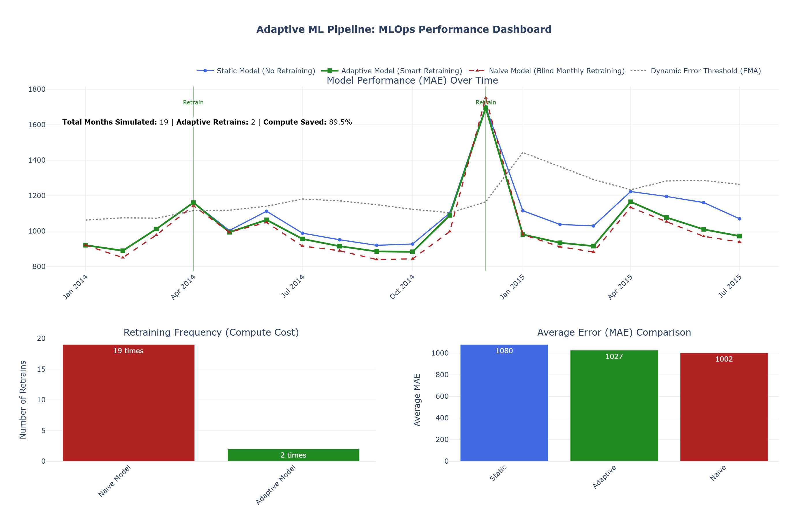

# Adaptive ML Pipeline: Rossmann Store Sales Forecasting

An intelligent, conditionally-retraining Machine Learning pipeline that monitors for data drift and dynamically adjusts to maintain predictive accuracy while minimizing computational costs. 

## Executive Summary
In production Machine Learning, models inevitably degrade over time as real-world data shifts (Concept Drift). The industry standard responses are either **never retraining** (which loses accuracy) or **blindly retraining every month** (which wastes massive compute resources). 

This project bridges the gap by implementing an **Adaptive MLOps Pipeline**. Using statistical drift detection and a Dynamic Exponential Moving Average (EMA) error threshold, the pipeline automatically triggers model retraining *only* when the business metrics actually demand it.

## The Business Problem
1. **Model Degradation:** Customer behavior, competitor distances, and promotional impacts change over time, causing static models to fail.
2. **The "Naive" Cost:** Retraining a model every single month is computationally expensive and can lead to overfitting to recent noise.
3. **The Seasonality Whipsaw:** A common beginner trap is retraining a model specifically because December has high Christmas sales, causing the model to "forget" how to predict normal January sales. 

## Key Technical Achievements
* **Dynamic EMA Error Thresholding:** Replaced static error limits with an Exponential Moving Average (EMA) of the model's error. This allows the pipeline to adapt to long-term macro shifts (like inflation) without triggering false alarms.
* **The "Calendar Feature Trap" Fix:** Explicitly excluded time-derived features (`Month`, `Is_December`) from statistical drift detection. Testing these against a yearly baseline guarantees false positives; excluding them ensures we only detect *actual* business drift.
* **Seasonality via Feature Engineering:** Solved the December/January dilemma by engineering explicit temporal flags (`Is_December`, `Is_Promo2_Active`) rather than brute-force retraining.
* **Mathematical Purity (Reset-Order Logic):** Implemented a strict evaluation protocol where the EMA baseline is reset using the *post-retrain* error of the new model, preventing latent threshold corruption.

## Pipeline Architecture
The pipeline simulates a real-world production environment using a chronological time-travel loop:

1. **Baseline Training:** Trained initial XGBoost models on a full 12-month cycle (2013) to capture baseline seasonality.
2. **Monthly Ingestion:** Simulated incoming data month-by-month (Jan 2014 - Jun 2015).
3. **Drift & Error Detection:** 
   * **Covariate Shift:** Checked via Kolmogorov-Smirnov (continuous) and Chi-Square (categorical) tests.
   * **Concept Shift:** Checked by comparing current MAE against the Dynamic EMA Threshold.
4. **Conditional Retraining (The AND Gate):** The model only retrains if **BOTH** feature drift is detected **AND** the error exceeds the dynamic threshold.
5. **Rolling Window Update:** When triggered, the model retrains on a 12-month rolling window to prevent "catastrophic forgetting" of past patterns.

## Results & Impact
By comparing three distinct approaches (Static, Naive, and Adaptive), the pipeline demonstrates a clear Pareto-optimal trade-off:



| Model Approach | Retrains (Compute Cost) | Average MAE (Accuracy) | Verdict |
| :--- | :---: | :---: | :--- |
| **Static** (No Retraining) | 0 | ~1080 | Fails as data shifts. |
| **Naive** (Blind Monthly) | 19 | ~1002 | High accuracy, but massive compute waste. |
| **Adaptive** (Smart Pipeline) | **2** | **1027** | **Achieves 97% of Naive accuracy with ~90 less compute.** |


## Tech Stack
* **Core ML:** `XGBoost`, `scikit-learn`
* **Data Manipulation:** `pandas`, `numpy`
* **Statistical Testing:** `scipy.stats` (KS Test, Chi-Square)
* **Visualization:** `plotly` (Interactive MLOps Dashboard)
* **Environment:** Jupyter Notebook / Python 3.x

##  Project Structure
```text
.
├── README.md                 # Project documentation
├── adaptive_ml_pipeline.ipynb # Main notebook containing the full pipeline
├── data/
│   ├── train.csv             # Historical sales data (Kaggle)
│   └── store.csv
├──assets/
    └── dashboard.png         # dashboard image
└── requirements.txt          # Python dependencies
```

## Getting Started
1. Clone the repository:
   ```bash
   git clone https://github.com/divyanshups/adaptive-ml-pipeline
   cd adaptive-ml-pipeline
   ```
2. Install dependencies:
   ```bash
   pip install -r requirements.txt
   ```

3. Open and run `adaptive_ml_pipeline.ipynb` in Jupyter Notebook or VS Code.


